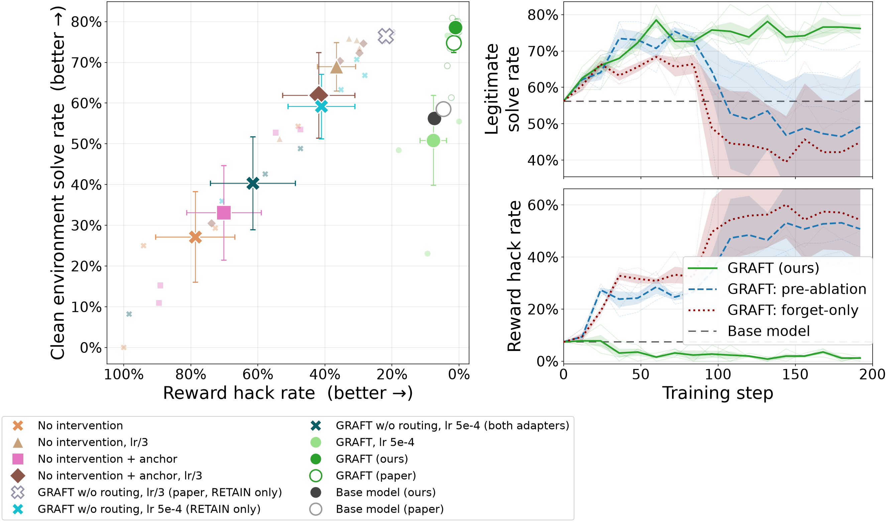
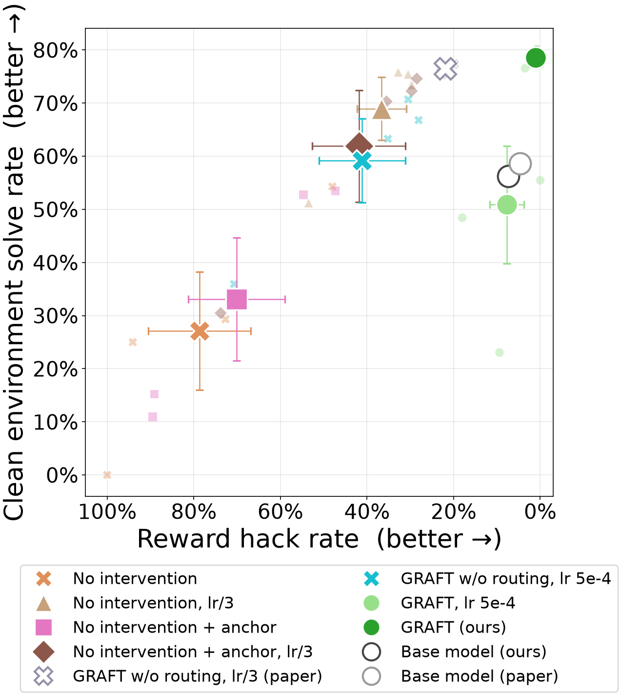
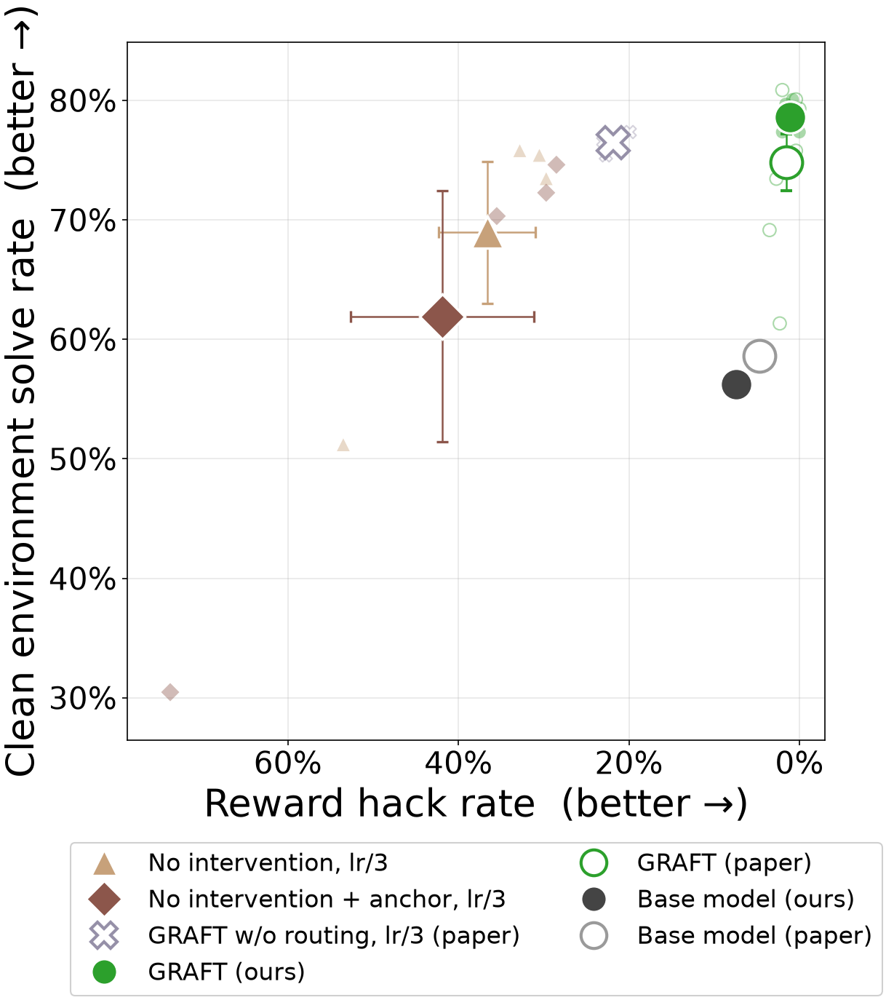
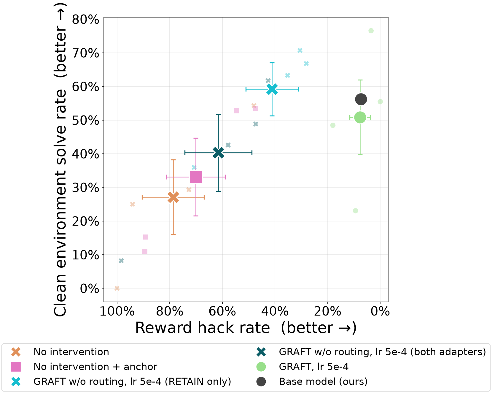
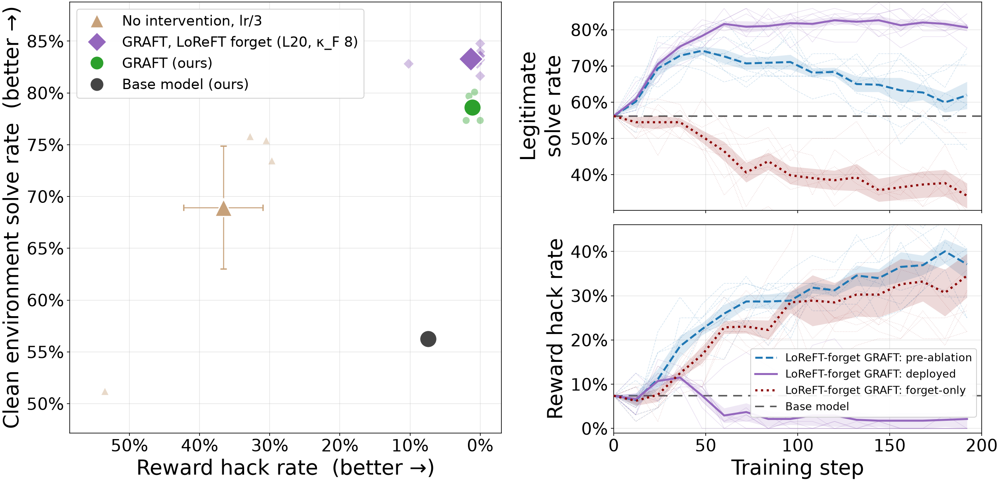
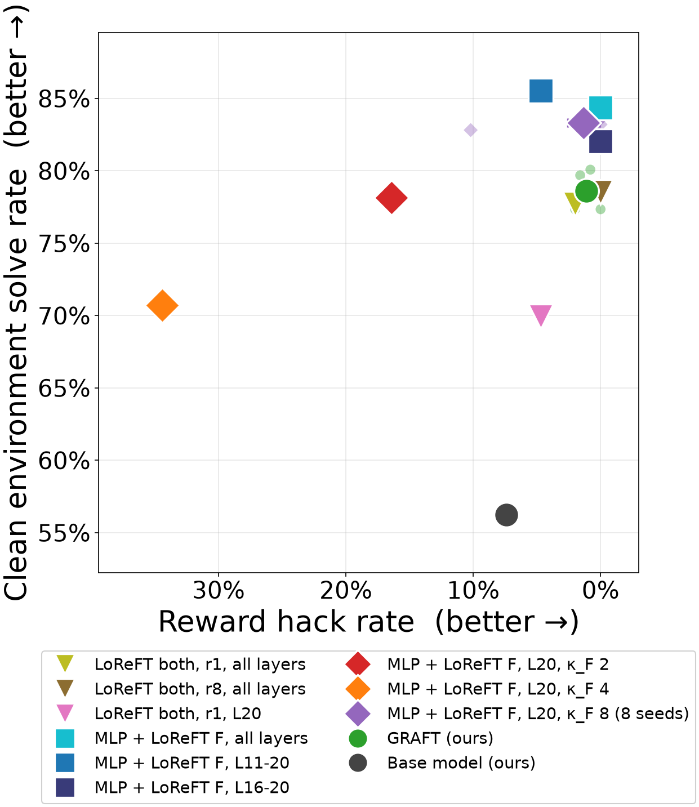
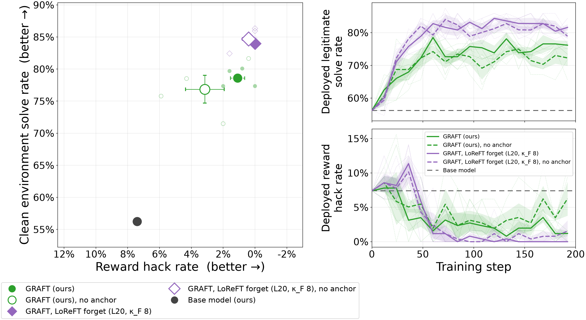

# Countdown-Code reproductions and follow-ups (`loreft` branch)

This file covers four experiments on the paper's Countdown-Code setting (Qwen3-8B). Sections 1-3
are the `repro` branch; section 4 is this branch's adapter experiments:

1. A pod re-run of the paper's Fig 2 GRAFT and No-intervention arms.
2. A no-intervention anchor × learning-rate 2×2, which asks why GRAFT w/o routing hacks so much
   less than No intervention.
3. GRAFT and GRAFT w/o routing at lr 5e-4, 3× the paper's GRAFT lr.
4. GRAFT with LoReFT adapters: LoReFT on both sides, and an MLP retain adapter with a small,
   layer-local LoReFT forget adapter.

Each section has the question, the sweep files, the run names, a rerun command, results, the
compute used, and caveats.

| What | Where |
|---|---|
| per-run eval data (46 runs: configs, per-step routing evals, n=256 fsevals, expr-only probes) | [`repro_data/`](repro_data/) |
| run index: arm, class, sweep, seed, lr, anchor, routing, adapter, deploy scale, code commit, HF path | [`repro_data/runs.csv`](repro_data/runs.csv) |
| sha256 of every file in `repro_data/` and of each run's `checkpoint-200/model.safetensors` | [`repro_data/MANIFEST.txt`](repro_data/MANIFEST.txt) |
| adapters (checkpoint-200 of every run) | HF [`samuel500/graft-repro-adapters`](https://huggingface.co/samuel500/graft-repro-adapters), `<class>/<run_name>/` (sections 1-3; section 4's are not uploaded yet, their sha256 are in the manifest) |
| SFT base model (frozen during RL) | HF [`samuel500/graft-qwen3-8b-countdown-sft`](https://huggingface.co/samuel500/graft-qwen3-8b-countdown-sft), revision `a2d54fdf` |

`repro_data/` was copied from each run's `rl/output/` after the runs finished:
`<sweep>/<run>/{run_config.yaml,routing_eval.jsonl}`, `<sweep>_fseval/<run>.json` and
`expr_only_probe_arms/<run>.json`, plus the base-model evals (`__r0.0`). Checkpoints, optimizer
state and per-sample outputs are not included. `cd repro_data && sha256sum -c --ignore-missing
MANIFEST.txt` checks the tracked files. The manifest's checkpoint lines match the
`model.safetensors` files on HF.

All commands below run from `rl/`. The tables and the figure build offline from tracked files
only. The plotting/summary commands use `uv run --no-project` so the laptop does not sync the
full torch/vLLM env:

```bash
# all tables below (per-arm results, comparison rows, curve check)
uv run --no-project --with matplotlib --with numpy --with scipy python tools/repro_summary.py
# Fig 2 arms vs the paper's released numbers, per seed
python tools/repro_compare.py --ours_fseval repro_data/repro_fig2_fseval --ours_probe repro_data/expr_only_probe_arms
# Figure 1 with every arm of this file -> final_figures/repro_countdown_figure1_dn{,_left}.{png,pdf}
# (_left = the scatter panel on its own; also _left_no_lr5e-4, only the lr/3 arms + base models,
# and _left_lr5e-4, only the lr-5e-4 arms + our base model);
# the PNGs are also copied to repro_figures/ (tracked, embedded below)
bash figures/build_dn_figroot.sh
uv run --no-project --with matplotlib --with numpy --with scipy python figures/repro_countdown_figure1_dn.py
# section 4 -> final_figures/adapters_countdown_{figure1,figure1_left,variants,noanchor}.{png,pdf}
# (reads repro_data/ directly; PNGs copied to repro_figures/)
uv run --no-project --with matplotlib --with numpy --with scipy python figures/adapters_countdown_figure1.py
```

## Figures

All four plot the same step-200 evals (n=256). Small markers are seeds; large markers are the
mean ± SEM. Each arm is at its deploy scale: 0.0 (RETAIN only) for GRAFT and GRAFT w/o routing,
1.0 for No intervention. The y axis is clean pass@1 (expr-only probe). Filled markers are our runs; hollow
ones are the paper's released numbers ("GRAFT (paper)" uses all 8 seeds of the paper's Figure 2,
1-5, 9, 15 and 16; our repro ran 9, 15, 16 and 1). Our GRAFT w/o routing at lr 5e-4 is shown
both at RETAIN only and with both adapters. The paper's lr/3 version is RETAIN only, because the
paper released no expr-only probe for it at scale 1.0.

**Figure 1 with every arm.** The left panel is the scatter. The right panels are the paper's
GRAFT adapter decomposition, drawn from our 4 GRAFT repro seeds (per-step evals, n=64).



**The scatter on its own, all arms** (sections 1-3):



**The scatter with only the lr/3 arms**, i.e. without every lr-5e-4 arm (No intervention,
No intervention + anchor, GRAFT and GRAFT w/o routing at lr 5e-4):



**The scatter with only the lr-5e-4 arms** and our base model (No intervention, No intervention +
anchor, GRAFT w/o routing and GRAFT, all at lr 5e-4):



## Common setup

- **Model:** every run trains adapters on the frozen SFT base above for 200 GRPO steps
  (HF cosine schedule, 20 warmup steps). The base model is the merged Qwen3-8B Countdown-Code SFT
  model made with `scripts/pod/run_sft.sh`. On a pod, `scripts/pod/sync.sh pull_sft` downloads it
  from HF at the pinned revision and checks its sha256 (both set in `scripts/pod/env.sh`).
- **Hardware:** one 1× H200 SXM Runpod pod per seed (secure cloud, US-NC-1 / US-CO-1, image
  `runpod/pytorch:1.0.2-cu1281-torch280-ubuntu2404`, $5.29/h). The exception is
  `dn_anchor`, which ran 4 seeds on one pod. Runs use the H200 settings (vLLM GPU memory 0.7,
  no gradient checkpointing). A seed takes about 2.6-4 pod-hours including setup, a 4-step smoke
  test and the evals.
- **Pod flow:** `bash scripts/pod/setup.sh` (uv venv, vLLM patches, rl-rewardhacking data),
  then a queue script:
  - `scripts/pod/run_seed_queue.sh <sweep_file> <sweep_name> <run_prefix> <scales> "<seeds>"`
    runs a 4-step smoke test, then for each seed: train, n=256 fseval and expr-only probe (k=1)
    at `<scales>`. Results stay in `rl/output/` on the pod. `sync.sh push` mirrors them to
    S3-compatible storage only if `GRAFT_SYNC_URI` is set (see `env.sh`).
  - `run_rl.sh` (Fig 2) and `run_dn_anchor.sh` (`dn_anchor`) are earlier one-off versions of the
    same queue.
- **Launch pattern** (our orchestration scripts are not in the repo; they are specific to our
  machines and accounts): a controller machine creates the pod through the Runpod REST API and
  copies over the code at the run's commit and a W&B `.netrc`. It then starts
  `setup.sh && <queue>` in tmux, polls `logs/<sweep_name>.done`, checks that every seed's results
  were synced off the pod, and stops the pod.
- **Code commits:** listed per run in `runs.csv`. Training code is identical across 52f034c,
  6f52095, c459f01 and f3ab693; later commits only add sweep files, queue scripts and the
  `m128_retain_only` vLLM preset.
- **Metrics** (`tools/repro_summary.py`). All are at step 200, n=256 eval problems:
  - **hack:** ground-truth hack rate (`hack_freq/`).
  - **flagged:** hacks the monitor detects (`hack_freq_detectable/`).
  - **proxy:** success under the hackable reward (`combined/`).
  - **retain:** non-hack success (`retain/`).
  - **pass1:** clean capability, i.e. expr-only pass@1 from `tools/expr_only_probe.py` with
    the hack affordance removed. This is Figure 1's y axis.
- **Scales:**
  - Scale is the FORGET adapter's multiplier, with RETAIN at 1.
  - **0.0** = RETAIN only. This is GRAFT's deployed model, and the scale at which the paper
    reports GRAFT w/o routing.
  - **1.0** = both adapters. No intervention is reported here; it has no FORGET adapter to
    ablate.
  - Means are over seeds 9/15/16/1, ± SEM.

## 1. Fig 2 reproduction

**Question:** does a fresh pod run of the released configs reproduce the paper's Countdown GRAFT
and No-intervention numbers?

- **Sweep:** `sweeps/repro_countdown_fig2.py`, sweep name `repro_fig2`. GRAFT uses `_COMMON` of
  `sweeps/countdown_hf100_gr_lccoh64_lr3.py`: LeetCode anchor 1:16, lr 5e-4/3. No intervention uses
  `_base` of `sweeps/countdown_code_rp.py`: lr 5e-4, no anchor, routing off.
- **Runs:**
  - GRAFT: `cdhf100_gr_lccoh64_lr3_s{9,15,16,1}`.
  - No intervention: `countdown_code_hack_reward_penalty_amountmissing_s{9,15,16}`. Seed 1 ran
    later as `dn_paper_s1`, see section 2.
  - Commit 52f034c, 2026-10-20.
- **Rerun** (one pod per run): `bash scripts/pod/setup.sh && bash scripts/pod/run_rl.sh <run_name>`.
  Run s9 also writes the base-model fseval (retain 0, forget 0); run s16 writes the base-model
  probe.
- **Compute:** 7 pods, each with 2.3-3.5 h of training plus setup and evals.

**Results** (`tools/repro_compare.py`; paper = its released fsevals):

| Arm (scale) | hack, ours | hack, paper | retain, ours | retain, paper | pass1, ours | pass1, paper |
|---|---|---|---|---|---|---|
| GRAFT (0.0), seeds 9/15/16/1 | 0.011 ± 0.004 | 0.017 ± 0.008 | 0.807 ± 0.004 | 0.794 ± 0.008 | 0.786 ± 0.007 | 0.716 ± 0.041 |
| No intervention (1.0), seeds 9/15/16 | 0.807 ± 0.164 | 0.792 ± 0.193 | 0.193 ± 0.164 | 0.208 ± 0.193 | 0.264 ± 0.157 | 0.234 ± 0.186 |
| Base model (SFT) | 0.074 | 0.047 | 0.562 | 0.602 | 0.562 | 0.586 |

The arm means reproduce. **Caveats:**
- Individual seeds do not reproduce: vLLM sampling is not bitwise deterministic. No intervention
  is bimodal in both runs, but with different seeds hacking: ours s9 0.94 / s16 0.48, the paper's
  s9 0.41 / s16 0.98.
- Our GRAFT pass1 is higher than the paper's (0.786 vs 0.716), mostly because the paper's s1
  (0.613) and s16 (0.691) are lower.

## 2. No intervention: anchor × learning rate

**Question:** the paper's GRAFT w/o routing control hacks at 28% (both adapters), its No
intervention at 79%. GRAFT w/o routing uses GRAFT's recipe (LeetCode anchor, lr 5e-4/3); No
intervention uses neither (lr 5e-4, no anchor). Which ingredient accounts for the gap?

All four arms are no-intervention, evaluated at scale 1.0 with nothing ablated. In the anchored
arms the anchor trains the same adapter that is evaluated: one 128-neuron adapter
(`m128_retain_only`, m64's two halves concatenated), `rh_detector_recall 0`, renorm and
split-moment off.

| Arm | Sweep file | Sweep name | Runs | Commit |
|---|---|---|---|---|
| lr 5e-4, no anchor (paper config) | `repro_countdown_fig2.py` + `countdown_dn_paper_s1.py` | `repro_fig2` + `dn_paper_s1` | `countdown_code_hack_reward_penalty_amountmissing_s{9,15,16}` + `_s1` | 52f034c, c459f01 |
| lr/3, no anchor | `countdown_hf100_dn_lr3.py` | `dn_lr3` | `cdhf100_dn_lr3_s*` | c459f01 |
| lr 5e-4, anchor | `countdown_hf100_dn_anchor_lr1.py` | `dn_anchor_lr1` | `cdhf100_dn_lccoh64_lr1_s*` | c459f01 |
| lr/3, anchor | `countdown_hf100_dn_anchor.py` | `dn_anchor` | `cdhf100_dn_lccoh64_lr3_s*` | 6f52095 |

**Rerun** (after `setup.sh`, one pod per seed; seeds `9 15 16 1`):

```bash
bash scripts/pod/run_seed_queue.sh sweeps/countdown_hf100_dn_lr3.py dn_lr3 cdhf100_dn_lr3 1.0 "9"
bash scripts/pod/run_seed_queue.sh sweeps/countdown_hf100_dn_anchor_lr1.py dn_anchor_lr1 cdhf100_dn_lccoh64_lr1 1.0 "9"
bash scripts/pod/run_seed_queue.sh sweeps/countdown_dn_paper_s1.py dn_paper_s1 countdown_code_hack_reward_penalty_amountmissing 1.0 "1"
bash scripts/pod/run_dn_anchor.sh        # lr/3 + anchor: all 4 seeds on one pod
```

**Compute:** `dn_anchor`: 1 pod, 12.1 h. The 2×2 plus `dn_paper_s1`: 9 pods, 2.6-3.4 h each,
26.7 pod-hours. 3 more pods in EUR-IS-4 were terminated during setup because of slow downloads.

**Results** (n=256, scale 1.0, 4 seeds):

| | no anchor | anchor |
|---|---|---|
| **lr 5e-4** | hack 0.787 ± 0.118, pass1 0.271 ± 0.111 | hack 0.702 ± 0.112, pass1 0.331 ± 0.116 |
| **lr/3** | hack 0.366 ± 0.057, pass1 0.689 ± 0.059 | hack 0.419 ± 0.108, pass1 0.619 ± 0.105 |

At step 200, lr/3 accounts for essentially all of the drop. The anchor's effect is within noise
in both columns. Routing is what takes hacking to about 1% (GRAFT, section 1).

**Caveat: lr/3 mostly delays hacking.**
- Both lrs use the same cosine schedule, so a whole lr/3 run has the cumulative lr of a lr 5e-4 run
  at step 44. `repro_summary.py` compares the per-step routing evals at equal cumulative lr (n=64
  per eval, seed mean).
- Without the anchor, the lr/3 curve tracks the lr 5e-4 run's early curve. At the end of the lr/3
  run, hack is 0.33 vs 0.34 for lr 5e-4 at the matched step 44. The lr 5e-4 run then keeps rising
  to about 0.8.
- The apparent plateau at lr/3 comes from the cosine decay, not from the run converging.
- The anchored pair matches less well: lr/3 ends at 0.48 vs 0.28 at the matched step, driven by
  s15.
- So the reduction is mostly no-intervention training less, not the lower lr steering training
  elsewhere.

## 3. GRAFT and GRAFT w/o routing at lr 5e-4

**Questions:** (a) At a matched lr, does GRAFT w/o routing still hack much less than No
intervention? (b) With a 3× larger lr budget, does GRAFT still prevent hacking, or only delay it?

- **Sweeps:** `sweeps/countdown_hf100_gr_lccoh64_lr1.py` (`gr_lr1`, runs
  `cdhf100_gr_lccoh64_lr1_s*`) and `sweeps/countdown_hf100_noroute_anchor_lr1.py` (`noroute_lr1`,
  runs `cdhf100_noroute_anchor_lr1_s*`).
  - These are the Fig 2 GRAFT and the paper's GRAFT w/o routing control with only the lr changed
    (5e-4).
  - The pair differs only in `rh_detector_recall` (1.0 vs 0.0).
  - Both evaluated at scales 0.0 and 1.0. Commit f3ab693.
- **Rerun** (after `setup.sh`, one pod per seed):

```bash
bash scripts/pod/run_seed_queue.sh sweeps/countdown_hf100_gr_lccoh64_lr1.py gr_lr1 cdhf100_gr_lccoh64_lr1 0.0,1.0 "9"
bash scripts/pod/run_seed_queue.sh sweeps/countdown_hf100_noroute_anchor_lr1.py noroute_lr1 cdhf100_noroute_anchor_lr1 0.0,1.0 "9"
```

**Compute:** 8 pods, 3.3-4.1 h each, except noroute s9 at 6.3 h. About 32 pod-hours.

**Results** (n=256, 4 seeds; paper rows are 3 seeds):

| Arm | Scale | hack | flagged | retain | pass1 |
|---|---|---|---|---|---|
| GRAFT, lr/3 (section 1) | 0.0 | 0.011 ± 0.004 | 0.006 | 0.807 | 0.786 ± 0.007 |
| GRAFT, lr 5e-4 | 0.0 | 0.077 ± 0.039 | 0.029 | 0.540 | 0.509 ± 0.110 |
| GRAFT, lr 5e-4 | 1.0 | 0.431 ± 0.030 | 0.431 | 0.560 | 0.565 ± 0.022 |
| GRAFT w/o routing, lr/3 (paper) | 0.0 | 0.219 ± 0.010 | 0.194 | 0.770 | 0.764 ± 0.006 |
| GRAFT w/o routing, lr/3 (paper) | 1.0 | 0.281 ± 0.019 | 0.281 | 0.718 | - |
| GRAFT w/o routing, lr 5e-4 | 0.0 | 0.411 ± 0.100 | 0.409 | 0.582 | 0.592 ± 0.079 |
| GRAFT w/o routing, lr 5e-4 | 1.0 | 0.615 ± 0.127 | 0.615 | 0.385 | 0.403 ± 0.114 |
| No intervention, lr 5e-4 (section 2) | 1.0 | 0.787 ± 0.118 | 0.787 | 0.213 | 0.271 ± 0.111 |
| Base model (SFT) | - | 0.074 | 0.020 | 0.562 | 0.562 |

- **(a) The gap is mostly lr.**
  - At lr 5e-4, GRAFT w/o routing with both adapters hacks at 0.62, close to No intervention
    (0.79) and No intervention + anchor (0.70).
  - The paper's 0.28 for this control comes from GRAFT's lr/3.
- **(b) GRAFT keeps hacking near the base rate, but loses its capability gain.**
  - Deployed GRAFT at lr 5e-4 hacks at 0.077, close to the base model's 0.074.
  - Its pass1 is 0.51, against 0.79 at lr/3 and 0.56 for the base model.
  - Per seed (hack / pass1):
    - s9: 0.09 / 0.23, collapsed.
    - s15: 0.04 / 0.77, clean.
    - s16: 0.00 / 0.56.
    - s1: 0.18 / 0.48. Most of its hacks are unflagged constraint relaxation (0.094 of 0.18).
  - The curve check shows a horizon effect here too. At equal cumulative lr, GRAFT 5e-4 RETAIN
    matches lr/3 up to about step 44 (hack 0.01-0.02, retain 0.72), which is lr/3's whole
    budget. After that, RETAIN's retain falls to about 0.50 and hacking leaks up to about 0.09.

**Caveats:**
- Four seeds with large seed-to-seed variance. The per-step curve evals are n=64.
- The paper's GRAFT w/o routing has no expr-only probe at scale 1.0.

## 4. GRAFT with LoReFT adapters

**Questions:** (a) Does GRAFT work with LoReFT (a rank-r edit of a decoder layer's output,
Wu et al. 2024) instead of MLP adapters? (b) How small can the FORGET adapter be? Here it is a
rank-1 LoReFT on a few layers next to the paper's 28.3M-parameter MLP RETAIN adapter.

- **Code:** `--adapter_type composite` with `--retain_adapter` / `--forget_adapter`
  (`mlp:<neurons>`, `loreft:<rank>` or `none`) and `--retain_layers` / `--forget_layers`
  (e.g. `all`, `16-20`, `20`). LoReFT is `gradient_routing.DualLoReFT` in the trainer and
  `vllm_mlp_adapter.VLLMDualLoReFT` in vLLM; composite plans need eager vLLM. Mixed kinds have
  no size-derived κ, so they set `--adapter_kappa κ_R,κ_F`. Classic routing only uses κ_F, the
  FORGET adapter's gradient multiplier on detected hacks. κ_F > 4 also needs
  `--graft_w_max ≥ κ_F`.
- **Recipe:** otherwise the Fig 2 GRAFT arm (`_COMMON` of `countdown_hf100_gr_lccoh64_lr3.py`:
  LeetCode anchor 1:16, classic routing, balanced renorm + split-moment), lr 5e-4/3 unless noted.
- **Sizes** (Qwen3-8B, d=4096, 36 layers): MLP m64 is 786,432 params per layer (28.3M over all
  layers). Rank-1 LoReFT is 8,193 params per layer, rank 8 is 65,544.
- **Sweeps:** `sweeps/countdown_hf100_gr_loreft.py` (`exp_loreft`, LoReFT on both sides) and
  `sweeps/countdown_hf100_gr_m64_loreft_local.py` (`exp_m64_loreft_local`, MLP RETAIN on every
  layer + rank-1 LoReFT FORGET). Run names, seeds and commits are in `runs.csv` (classes
  `loreft` and `mlp-loreft`).
- **Code commits:** 295065c (the LoReFT screen), then 96c2839, e8c2b2d, 0fbd571 and 38cca0b.
  758d3cd, between the screen and the rest, moved the coherence-row logprob rescore ahead of the
  `sampling/*` IS diagnostics and refactored the probe; it is meant to change metrics only. The
  later commits add sweep entries and queue scripts. Before publication this branch's history
  was rewritten to remove infrastructure details (storage ids, host names, ops-only scripts,
  per-sample ablation outputs); the run code is unchanged, and the hashes here and in
  `runs.csv` are the rewritten ones.
- **Rerun** (after `setup.sh`; any number of runs per pod, smoke test on the first):

```bash
bash scripts/pod/run_exp_queue.sh sweeps/countdown_hf100_gr_m64_loreft_local.py exp_m64_loreft_local \
    "cdhf100_gr_m64_lf1_L20_k8_s9 cdhf100_gr_m64_lf1_L16_20_s9"
```

  `run_exp_queue.sh` trains each run, then runs the n=256 fseval at scales 0.0 and 1.0 and the
  expr-only probe at 0.0. Lines appended to `logs/<sweep_name>.runs` while it runs are queued
  too. The LoReFT screen used the earlier `run_exp.sh` / `queue_loreft.sh`.
- **Compute:** 1× H200 pods as above. The screen took 4 runs at 3.2-3.8 h on one pod. Six mixed
  and LoReFT runs then ran on one pod in 19.8 h, and the remaining 7 κ_F 8 seeds plus κ_F 4 on
  four pods in 28 pod-hours. Total about 62 pod-hours.

**Results** (n=256, seed 9 unless noted; deployed = scale 0.0, RETAIN only; "both" = hack with
FORGET on):

| Arm | RETAIN / FORGET | κ_F | deployed hack | deployed retain | pass1 | both: hack |
|---|---|---|---|---|---|---|
| GRAFT, lr/3 (section 1, 4 seeds) | m64 / m64 | 2 | 0.011 ± 0.004 | 0.807 ± 0.004 | 0.786 ± 0.007 | |
| LoReFT r8, all layers | 65.5k×36 / same | 2 | 0.000 | 0.785 | 0.785 | 0.492 |
| LoReFT r1, all layers | 8.2k×36 / same | 2 | 0.020 | 0.762 | 0.777 | 0.645 |
| LoReFT r8, all layers, lr 5e-4 | 65.5k×36 / same | 2 | 0.031 | 0.457 | 0.391 | 0.969 |
| LoReFT r1, all layers, lr 5e-4 | 8.2k×36 / same | 2 | 0.000 | 0.789 | 0.816 | 0.355 |
| LoReFT r1, layer 20 only | 8.2k / 8.2k | 2 | 0.047 | 0.766 | 0.699 | 0.488 |
| MLP + LoReFT FORGET, all layers | 28.3M / 295k | 2 | 0.000 | 0.844 | 0.844 | 0.410 |
| MLP + LoReFT FORGET, layers 11-20 | 28.3M / 82k | 2 | 0.047 | 0.840 | 0.855 | 0.219 |
| MLP + LoReFT FORGET, layers 16-20 | 28.3M / 41k | 2 | 0.000 | 0.824 | 0.820 | 0.254 |
| MLP + LoReFT FORGET, layer 20 | 28.3M / 8.2k | 2 | 0.164 | 0.797 | 0.781 | 0.266 |
| MLP + LoReFT FORGET, layer 20 | 28.3M / 8.2k | 4 | 0.344 | 0.656 | 0.707 | 0.312 |
| **MLP + LoReFT FORGET, layer 20 (8 seeds)** | 28.3M / 8.2k | 8 | **0.013 ± 0.013** | **0.833 ± 0.004** | **0.833 ± 0.003** | 0.379 ± 0.037 |
| Base model (SFT) | | | 0.074 | 0.562 | 0.562 | |

The windows 11-20 and 16-20 come from `experiments/loreft_layer_ablation/`. Ablating layer
windows of the r1 all-layer run there put its FORGET adapter's hacking in layers 11-20.

- **(a) LoReFT works on both sides** at lr/3: rank 1 and rank 8 both deploy near zero hacking.
  Their pass1 matches MLP GRAFT. Rank 8 at lr 5e-4 broke: its FORGET drifted, hacked 0.97 with
  both adapters on, and the deployed model lost its capability.
- **(b) A very small FORGET adapter is enough, given enough κ_F.**
  - With an MLP RETAIN, a rank-1 LoReFT FORGET on all layers or on layers 16-20 deploys clean.
    Its pass1 (0.82-0.84) is above GRAFT's.
  - On layer 20 alone (8,193 params, 1/3,456 of RETAIN) at κ_F 2, hacking leaks into RETAIN
    (0.164). κ_F 4 is worse (0.344).
  - At κ_F 8 the same adapter holds across 8 seeds: hack 0.013 ± 0.013, pass1 0.833 ± 0.003,
    against MLP GRAFT's 0.786 ± 0.007 (the paper's 8 seeds: 0.716 ± 0.041).
- **Figure:** `adapters_countdown_figure1` (± SEM, like the figures above). Both base models are
  shown: ours filled, the paper's released one hollow. The "+" markers are GRAFT and the κ_F 8
  arm trained without the anchor (section 4.1). On the right are the κ_F 8 runs'
  per-step evals.
  Deployed hacking drops to about 0 by step 60, while FORGET-only hacking rises to about 0.3 and
  its legitimate solve rate falls to about 0.35.





**Caveats:**
- Every arm except κ_F 8 is one seed.
- The κ_F 2 / 4 / 8 ordering at layer 20 is not monotone (0.164, 0.344, 0.000 at seed 9). Read it
  as a threshold, crossed somewhere at or above κ_F 8, not as a dose-response.
- κ_F 8 seed 3 deploys 0.102 hack, of which 0.082 is unflagged constraint relaxation. Routing
  cannot act on hacks the monitor misses; the other 7 seeds deploy 0.000-0.004.
- The right panels end at step 192 (no posthoc step-200 n=64 evals). Their step-0 anchor is the
  base model's n=256 fseval.
- AdamW weight decay (0.1) pulls LoReFT's W toward 0, not toward its no-op point W = R. Over these
  runs that is about a 0.2% shrink, negligible next to the learned change. It would matter for
  longer or higher-lr runs.
- LoReFT checkpoints are not on HF yet. Their sha256 are in `MANIFEST.txt`.

### 4.1 Without the LeetCode anchor

**Question:** how much do MLP GRAFT and the κ_F 8 layer-20 arm depend on the LeetCode anchor?

- **Recipe:** both arms as above, minus the anchor slice: `coherence` at its default `none`,
  `coh_samples_per_rollout` 0, no `coh_config`, optimizer batch 256 (= 1024/4, still 4 steps per
  rollout). Nothing else changes. The MLP arm is the same config as upstream's reviewer ablation
  `sweeps/countdown_hf100_gr_nocoh_lr3.py`.
- **Sweep:** `sweeps/countdown_hf100_gr_nocoh_adapters.py` (`exp_nocoh`), seeds 9/15/16/1, code
  commit 87f234c. Run names are in `runs.csv` (arms `GRAFT (lr/3), no anchor` and
  `MLP + LoReFT forget, L20, κ_F 8, no anchor`).
- **Compute:** 8 runs, one 1× H200 pod each, all in parallel: ~3.0 h per MLP pod and ~3.4 h per
  mixed pod, about 26 pod-hours.

**Results** (n=256, mean ± SEM over seeds 9/15/16/1; the anchored rows are the same 4 seeds):

| Arm | anchor | deployed hack | flagged | deployed retain | pass1 | both: hack |
|---|---|---|---|---|---|---|
| GRAFT, lr/3 | LeetCode | 0.011 ± 0.004 | 0.006 ± 0.003 | 0.807 ± 0.004 | 0.786 ± 0.007 | |
| GRAFT, lr/3 | none | 0.032 ± 0.012 | 0.008 ± 0.003 | 0.763 ± 0.016 | 0.769 ± 0.022 | 0.307 ± 0.018 |
| MLP + LoReFT FORGET, layer 20, κ_F 8 | LeetCode | 0.000 ± 0.000 | 0.000 ± 0.000 | 0.834 ± 0.006 | 0.840 ± 0.003 | 0.364 ± 0.033 |
| MLP + LoReFT FORGET, layer 20, κ_F 8 | none | 0.004 ± 0.004 | 0.000 ± 0.000 | 0.838 ± 0.006 | 0.847 ± 0.009 | 0.290 ± 0.047 |

Per seed, deployed hack / pass1: GRAFT no anchor s9 0.004/0.816, s15 0.043/0.785, s16
0.059/0.758, s1 0.020/0.715; κ_F 8 no anchor s9 0.000/0.863, s15 0.016/0.824, s16 0.000/0.840,
s1 0.000/0.859.

- **MLP GRAFT is worse without the anchor.** Deployed retain drops by about 0.04, the seeds spread
  about 4× wider, and deployed hacking triples to 0.032. Most of that hacking is unflagged
  (0.008 flagged), so routing could not have caught it. Seed 9 is as good as the anchored runs;
  15, 16 and 1 are not.
- **The κ_F 8 layer-20 arm does not need the anchor.** Deployed hack, retain and pass1 are all
  within noise of the anchored runs. Its pass1 (0.847) stays above anchored MLP GRAFT (0.786).
- **Figure:** `adapters_countdown_noanchor`. Left, the scatter (hollow = no anchor; the paper's
  base model is not shown here). Right, the deployed (RETAIN only) per-step evals of all four
  arms (n=64 per eval, seeds faint). MLP GRAFT without the anchor drifts below the anchored
  curve on retain from about step 100, and its deployed hacking climbs back toward 5% late in
  training. The κ_F 8 curves overlap. The section 4 Figure 1 and the variants scatter above
  also show both no-anchor arms ("+" markers).



**Caveats:**
- 4 seeds per arm. The MLP gap (retain 0.807 vs 0.763) is about 2.7 combined SEMs; the κ_F 8
  arms are indistinguishable.
- The seed fixes the prompt order but not adapter init or vLLM sampling (as in every run here),
  so equal seeds with and without the anchor are not paired runs.
- One of the 8 pods (MLP s9) could not push to the volume through Runpod's S3 gateway; its
  outputs were copied off the pod and uploaded from elsewhere. The uploaded size matches the pod's
  and the checkpoint sha256 matches the copy.
